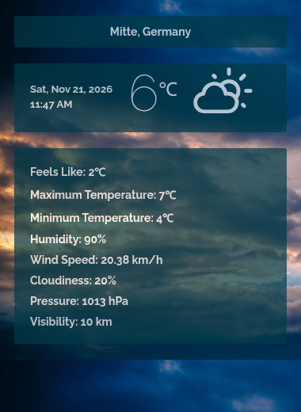

# Metis Weather

[](https://github.com/kasramp/weather-extension/actions/workflows/release.yml)

A weather popup extension for Chrome, Chromium and Firefox. Click the toolbar icon and see the current weather for where you are. Built on top of the [Eris API](https://weather-api.madadipouya.com) ([source](https://github.com/kasramp/Eris)).



## Requirements

- Chrome or Chromium (Manifest V3), or Firefox 140+ on desktop

## Installation

Store listings: Chrome Web Store (coming soon), Firefox Add-ons (coming soon).

### From a release zip

Download `metis-weather-<version>-chrome.zip` or `metis-weather-<version>-firefox.zip` from the [releases](https://github.com/kasramp/weather-extension/releases) page.

- Chrome / Chromium: unzip it, open `chrome://extensions/`, enable developer mode, click "Load unpacked" and pick the unzipped folder.
- Firefox: open `about:debugging#/runtime/this-firefox`, click "Load Temporary Add-on" and pick the zip. Temporary add-ons are removed when Firefox restarts.

## How it works

- When the popup opens it asks the browser for your location and asks Eris for the weather there.
- If location is denied or unavailable it falls back to an IP lookup.
- The last result is cached in `localStorage` and shown right away while a fresh one loads.
- The only permission is `geolocation`. No remote fonts or scripts.

## Development

Needs Node 24 (see `.nvmrc`).

```
$ git clone https://github.com/kasramp/weather-extension
$ cd weather-extension
$ npm ci
$ npm run dev
```

`npm run dev` rebuilds into `dist/` on every change. Load `dist/` unpacked as described above.

| Command            | Action                                      |
| ------------------ | ------------------------------------------- |
| `npm run build`    | Production build into `dist/`               |
| `npm test`         | Run the tests (vitest)                      |
| `npm run lint`     | ESLint and Prettier check                   |
| `npm run format`   | Format with Prettier                        |
| `npm run lint:ext` | `web-ext lint` on `dist/`                   |
| `npm run package`  | Build the zips into `dist-zip/` (see below) |

## Release process

CI (`.github/workflows/ci.yml`) runs lint, tests, build and `web-ext lint` on pull requests.

Merging to master runs `.github/workflows/release.yml`: it runs the checks, and if a tag for the `package.json` version already exists it bumps the patch version and commits `Release v<version>`. It then builds, tags `<version>` and creates a GitHub release with three zips: `chrome`, `firefox` and `source`. To release a minor or major version, edit `version` in `package.json` in the pull request.

Store submission steps are in [publish/](publish/CHECKLIST.md).

The old 1.0.x (Manifest V2) is archived as release [1.0.19](https://github.com/kasramp/weather-extension/releases/tag/1.0.19).

## Contact

kasra@madadipouya.com

## License

MIT
